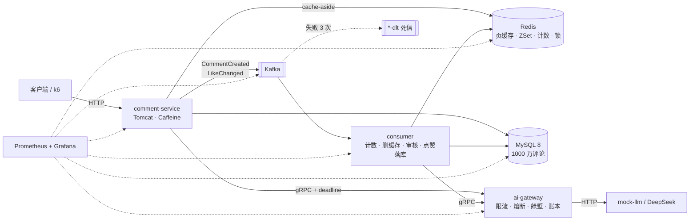

<div align="center">

# 💬 comment-hub

### *短视频评论区后端，带大模型审核和摘要。每个优化都配一个朴素版，用压测数字对比*

[](https://github.com/Mist-wu/comment-hub/actions)

[为什么](#为什么做-comment-hub) • [快速开始](#快速开始) • [用法](#用法) • [原理](#原理) • [文档](#文档)

</div>

> [!NOTE]
> 练习项目。数据是生成的：1 万个视频、1000 万条评论、5032 万个点赞，视频热度服从 Zipf(s=1.1)，前 1% 的视频拿走 65% 的评论。

## 为什么做 comment-hub？

热门视频会把流量集中到少数几个 key 上，写入会突然暴涨，模型服务会变慢或挂掉。这个项目要回答：这些时候评论区还能不能用，数据对不对，花多少钱。每个优化都先写朴素版再写优化版，两者只差一个运行时开关，用同一份数据压测，3 次取中位数。

- **热点读不打到数据库**：页缓存、热 key 本地缓存、互斥锁、布隆过滤器挡在 MySQL 前面，QPS 从 250 提高到 9,680，P99 从 2.4 秒降到 52ms。
- **点赞风暴没有行锁等待**：INSERT IGNORE + Redis INCR + Kafka 合并落库，QPS 从 1,230 提高到 6,054，18 万次点赞合并成 3,513 次 UPDATE。
- **模型挂了评论区照常用**：deadline 层层传递，加上异步摘要、舱壁和熔断。模型延迟 10 秒、错误率 50% 的 90 秒里，读 P99 一直是 5.3ms。
- **真模型算过账**：在 540 条标注样本上测 DeepSeek，边界用例准确率 97.5%（关键词规则 35%），审核一条评论 0.000575 元。
- **三篇故障复盘**：误删索引、模型调用无超时、热点 key 击穿，每篇都有复现脚本、监控图和修复前后的数字。

<details>
<summary><b>朴素版 → 优化版全部对比</b></summary>

| 场景 | 朴素版 | 优化版 | 结果 |
|---|---|---|---|
| 热点视频读评论（Zipf，200 VU） | 直查 MySQL，实时排序和 COUNT | Redis 页缓存 + 热 key 本地缓存 + ZSet + 计数器 + 布隆过滤器 | QPS 250 → 9,680，P99 2,400 → 52 ms |
| 点赞风暴（200 VU 点同一条评论） | 一个事务里 INSERT + UPDATE 热点行 | INSERT IGNORE + Redis INCR + Kafka 合并落库 | QPS 1,230 → 6,054，行锁等待 38,136 → 0 次 |
| 模型故障（延迟 10 秒 + 50% 错误） | 同步等模型，不设超时 | deadline + 异步摘要 + 舱壁 + 熔断 + 降级 | 读 P99 18,879 → 5.3 ms，Tomcat 忙线程 200 → 6 |
| 深分页（151 万条评论的第 1000 页） | `LIMIT 19980, 20` | 游标 `(created_at, id) < (?, ?)` | P99 174 → 3.8 ms |
| 慢 SQL：最热榜重建 | filesort 162 万行 | 覆盖索引 `(video_id, like_count, id, status)` | 单条 SQL 1,309 → 0.245 ms |
| 缓存击穿（热点 key 每 10 秒过期） | 直接回源 | Redis 互斥锁 / 逻辑过期 | 60 秒回源 2,187 → 6 次，QPS 2,127 → 14,519 |
| 缓存穿透（一半请求查不存在的视频） | 直接回源 | 布隆过滤器 | MySQL QPS 5,216 → 305 |
| 突发写（目标 3000/s） | 请求里同步计数、删缓存、审核 | 写库 + 发事件，consumer 批量处理 | 吞吐没有提升，两版都卡在磁盘 fsync，约 1,600/s。热点行锁等待 16,787 → 0 |

突发写的吞吐受限于这台机器 VM 磁盘的 fsync，异步化没能提高它。排查过程见 [benchmark.md 场景 2](docs/benchmark.md#场景-2突发写评论)。

</details>

## 快速开始

需要 Docker（至少 6 核 10G 内存）和 k6。只有跑测试才需要 JDK 21。

### 安装

```sh
git clone https://github.com/Mist-wu/comment-hub.git && cd comment-hub
cp .env.example .env     # 只有真模型评估才需要填 DEEPSEEK_API_KEY
docker compose up -d     # MySQL、Redis、Kafka、4 个服务、Prometheus、Grafana
```

### 运行

```sh
docker compose --profile datagen run --rm datagen --videos 1000 --comments 200000 --likes 1000000
```

这是小规模数据，几秒生成完。去掉参数生成全量数据（1000 万评论 / 5000 万点赞），约 5 分钟。

### 看到结果

```sh
curl -s 'localhost:8080/api/videos/1/comments?sort=hot&size=3'
```

返回 1 号视频点赞最多的 3 条评论：

```json
{"items":[{"id":169422,"videoId":1,"content":"破防了，开头三秒要是早点发就好了！！","likeCount":11825,"status":1,...}, ...]}
```

Grafana 在 http://localhost:3000，面板叫“comment-hub”。

## 用法

### 发评论和点赞

```sh
curl -s -XPOST localhost:8080/api/videos/1/comments -H 'Content-Type: application/json' -d '{"userId":42,"content":"好看"}'
curl -s -XPOST localhost:8080/api/comments/1/like -H 'Content-Type: application/json' -d '{"userId":42}'
```

### 压测朴素版和优化版

```sh
bench/all.sh micro    # 分页、最热排序、击穿 / 穿透 / 雪崩、热 key
bench/all.sh main     # 四个主场景，朴素版和优化版各 3 次
```

结果写进 `bench/results/`，表格见 [docs/benchmark.md](docs/benchmark.md)。

### 复现故障

```sh
scripts/incidents/01-slow-sql.sh          # 误删索引 → 慢 SQL
scripts/incidents/02-no-timeout.sh        # 模型无超时 → 线程池耗尽
scripts/incidents/03-breakdown-pool.sh    # 热点 key 击穿 → 连接池耗尽
```

每次演练的证据和图表写入独立的 `logs/<脚本名>.<随机后缀>/` 目录。仓库保留的历史记录在 `docs/incidents/`。

### 运行时开关

朴素版和优化版靠 `localhost:8080/admin/toggles` 切换，`GET` 查看当前值，`POST` 一个 JSON 修改，比如 `{"breakdown":"NONE"}`。最常改的几个：

| 开关 | 作用 | 取值（默认在前） |
|---|---|---|
| `hotMode` | 最热排序读 ZSet 还是实时 ORDER BY | `ZSET` / `DB` |
| `breakdown` | 缓存击穿保护 | `MUTEX` / `LOGICAL` / `NONE` |
| `penetration` | 缓存穿透保护 | `BLOOM` / `NULL_VALUE` / `NONE` |
| `likeMode` | 点赞走 Redis + Kafka 还是直接写库 | `REDIS` / `DB` |
| `syncWrite` | 发评论时在请求里同步计数、删缓存、审核 | `false` / `true` |
| `summaryDeadlineMs` | 取 AI 摘要的 gRPC deadline | `150` |

## 原理



trace ID 从 HTTP 头开始，依次带过 gRPC metadata 和 Kafka 消息头，用一条 grep 就能把一次发评论在四个服务里的日志串起来。

技术栈：Java 21 · Spring Boot 3.3 · MyBatis-Plus · MySQL 8.4 · Redis 7.4 · Caffeine · Kafka 3.8（KRaft）· gRPC · Resilience4j · Micrometer + Prometheus + Grafana · JUnit 5 + Mockito + Testcontainers · k6 · Docker Compose

## 文档

- [设计说明](docs/design.md)：索引、隔离级别、MVCC 与热点行、cache-aside、三类缓存问题、一致性窗口和对账、Kafka 幂等和死信、模型网关，每个设计为什么这样做。
- [压测报告](docs/benchmark.md)：全部压测数字、机器配置、EXPLAIN 和 GC 统计。
- [成本](docs/cost.md)：真模型的审核质量、调用次数、token 和费用。
- [故障复盘](docs/incidents/)：三篇，每篇按“现象 → 怎么发现 → 怎么定位 → 根因 → 修复 → 修复后的数字”写。
