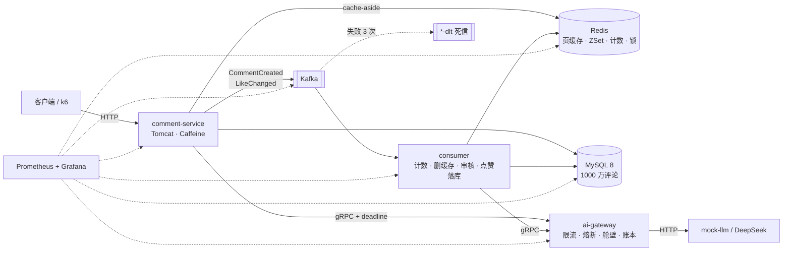

# comment-hub

短视频评论区后端：发评论、拉评论、点赞，加上大模型审核和评论区摘要。这个项目要回答的问题是：**热门视频把流量集中到少数几个 key 上、写入突然暴涨、模型服务变慢或挂掉的时候，评论区还能不能用，数据对不对，花多少钱。**

每个优化都先写一个朴素版，再写优化版，两者只差一个运行时开关，用同一份数据压测（3 次取中位数）。下面的数字都来自 [docs/benchmark.md](docs/benchmark.md)。

> 数据是**生成的**：1 万个视频、1000 万条评论、5032 万个点赞。视频热度服从 Zipf(s=1.1)，前 1% 的视频拿走 65% 的评论。生成器见 `datagen/`。



trace ID 从 HTTP 头开始，依次带过 gRPC metadata 和 Kafka 消息头，用一条 grep 就能把一次发评论在四个服务里的日志串起来。

## 朴素版 → 优化版

| 场景 | 朴素版 | 优化版 | 结果 |
|---|---|---|---|
| 热点视频读评论（Zipf，200 VU） | 直查 MySQL，实时排序和 COUNT | Redis 页缓存 + 热 key 本地缓存 + ZSet + 计数器 + 布隆过滤器 | QPS **250 → 9,680**，P99 2,400 → 52 ms |
| 点赞风暴（200 VU 点同一条评论） | 一个事务里 INSERT + UPDATE 热点行 | INSERT IGNORE + Redis INCR + Kafka 合并落库 | QPS **1,230 → 6,054**，行锁等待 38,136 → 0 次 |
| 模型故障（延迟 10 秒 + 50% 错误） | 同步等模型，不设超时 | deadline + 异步摘要 + 舱壁 + 熔断 + 降级 | 读 P99 **18,879 → 5.3 ms**，Tomcat 忙线程 200 → 6 |
| 深分页（151 万条评论的第 1000 页） | `LIMIT 19980, 20` | 游标 `(created_at, id) < (?, ?)` | P99 174 → 3.8 ms |
| 慢 SQL：最热榜重建 | filesort 162 万行 | 覆盖索引 `(video_id, like_count, id, status)` | 单条 SQL 1,309 → 0.245 ms |
| 缓存击穿（热点 key 每 10 秒过期） | 直接回源 | Redis 互斥锁 / 逻辑过期 | 60 秒回源 2,187 → 6 次，QPS 2,127 → 14,519 |
| 缓存穿透（一半请求查不存在的视频） | 直接回源 | 布隆过滤器 | MySQL QPS 5,216 → 305 |
| 突发写（目标 3000/s） | 请求里同步计数、删缓存、审核 | 写库 + 发事件，consumer 批量处理 | **吞吐没有提升**：两版都卡在磁盘 fsync，约 1,600/s。热点行锁等待 16,787 → 0 |

## 三个结论

1. **热点问题的关键是别让请求走到数据库。** 热点读朴素版的 P99 是 2.4 秒，连接池等待 170。挡在数据库前面的有：页缓存、热 key 本地缓存、互斥锁、布隆过滤器。加上之后 QPS 提高 38.7 倍，MySQL QPS 从“每个请求都要查”降到平均 2,107，而这时总 QPS 已经接近 1 万。击穿实验里，60 秒内同一个 key 回源了 2,187 次，加锁后只剩 6 次。
2. **模型调用必须有超时，而且超时要层层传递。** 不设超时时，一个可选的摘要功能就让 Tomcat 200 个线程全部卡住，连不调模型的接口和监控端点都挂了（[复盘 02](docs/incidents/02-no-timeout.md)）。加了 deadline、异步摘要、舱壁和熔断之后，模型故障 90 秒期间，读 P99 一直是 5.3ms。熔断器在故障后 3 秒打开，恢复后 1.3 秒关闭。
3. **真模型要先关掉思考模式再上线。** 在 540 条标注样本上测 DeepSeek：
   - 边界用例（谐音、变体联系方式、含敏感词的正常评论）上，模型准确率 97.5%，关键词规则只有 35%。
   - 关掉思考模式后，解析失败从 7 降到 0，输出 token 少 55%，费用少 37%。
   - 按高峰价，审核一条评论 0.000575 元。

   见 [docs/cost.md](docs/cost.md)。

也有没做到的：突发写的吞吐受限于这台机器 VM 磁盘的 fsync，异步化没能提高它。排查过程（日志锁、fsync、consumer 批量提交）写在 [benchmark.md 场景 2](docs/benchmark.md#场景-2突发写评论)。

## 运行

需要 Docker（至少 6 核 10G 内存）、k6、JDK 21（只有跑测试才需要）。

```bash
cp .env.example .env                                   # 只有真模型评估才需要填 DEEPSEEK_API_KEY
docker compose up -d                                   # MySQL、Redis、Kafka、4 个服务、Prometheus、Grafana
docker compose --profile datagen run --rm datagen      # 生成 1000 万评论 / 5000 万点赞，约 5 分钟
```

小规模试跑：

```bash
docker compose --profile datagen run --rm datagen --videos 1000 --comments 200000 --likes 1000000
```

| 地址 | 内容 |
|---|---|
| http://localhost:8080 | comment-service（`/api/...`，开关在 `/admin/toggles`） |
| http://localhost:3000 | Grafana，面板“comment-hub” |
| http://localhost:9095 | Prometheus |
| http://localhost:8000 | mock-llm，`/admin/config` 注入延迟 / 错误率 / 挂起 |

试一下：

```bash
curl -s 'localhost:8080/api/videos/1/comments?sort=hot&size=3' | jq
curl -s -XPOST localhost:8080/api/videos/1/comments -H 'Content-Type: application/json' -d '{"userId":42,"content":"好看"}'
curl -s -XPOST localhost:8080/api/comments/1/like -H 'Content-Type: application/json' -d '{"userId":42}'
```

压测和复盘：

```bash
bench/all.sh micro          # 分页、最热排序、击穿 / 穿透 / 雪崩、热 key
bench/all.sh main           # 四个主场景，朴素版和优化版各 3 次
scripts/incidents/01-slow-sql.sh        # 误删索引 → 慢 SQL
scripts/incidents/02-no-timeout.sh      # 模型无超时 → 线程池耗尽（jstack）
scripts/incidents/03-breakdown-pool.sh  # 热点 key 击穿 → 连接池耗尽
scripts/replay-dlt.sh comment-created   # 把死信重放回原 topic
```

测试（单元测试，加上用 Testcontainers 起 MySQL、Redis、Kafka 的集成测试；GitHub Actions 上跑的也是这条命令）：

```bash
mvn -Pit verify
```

## 文档

- [docs/design.md](docs/design.md)：每个设计为什么这样做，包括索引、隔离级别、MVCC 与热点行、cache-aside、三类缓存问题、一致性窗口和对账、Kafka 幂等和死信、模型网关。
- [docs/benchmark.md](docs/benchmark.md)：全部压测数字、机器配置、EXPLAIN 和 GC 统计。
- [docs/cost.md](docs/cost.md)：真模型的审核质量、调用次数、token 和费用。
- [docs/incidents/](docs/incidents/)：三篇故障复盘，每篇按“现象 → 怎么发现 → 怎么定位 → 根因 → 修复 → 修复后的数字”写。

## 技术栈

Java 21 · Spring Boot 3.3 · MyBatis-Plus · MySQL 8.4 · Redis 7.4 · Caffeine · Kafka 3.8（KRaft）· gRPC · Resilience4j · Micrometer + Prometheus + Grafana · JUnit 5 + Mockito + Testcontainers · k6 · Docker Compose
