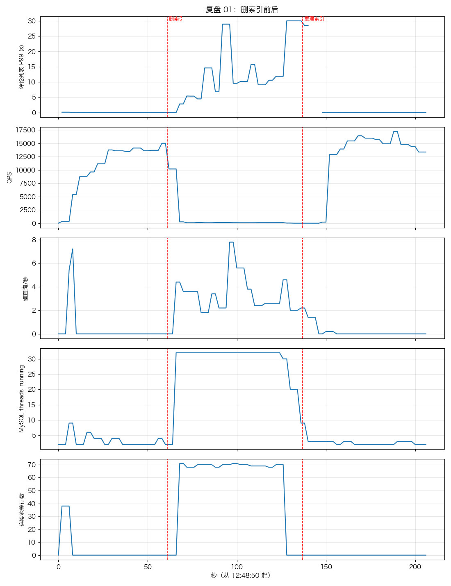

# 复盘 01：误删索引，评论列表变成慢 SQL

- 复现脚本：`scripts/incidents/01-slow-sql.sh`
- 证据：`docs/incidents/evidence/01/`
- 监控图：`docs/incidents/img/01-slow-sql.png`
- 时间：2026-11-19 12:48:50 起，单机压测环境，数据量见 README



## 现象

压测流量是热点读场景（Zipf 分布，100 VU）。第 61 秒执行 `ALTER TABLE comment DROP INDEX idx_video_created` 之后：

| 阶段 | QPS | P50 | P99 | 错误率 |
|---|---|---|---|---|
| 删索引前 | 11,897 | 6.8 ms | 30.1 ms | 0 |
| 删索引后 | **103** | 1.9 ms | **14,457 ms** | **9.94%** |

P50 几乎没变，P99 却涨了 480 倍，说明不是所有请求都变慢了：命中缓存的首页照常返回，打到数据库的请求要么等十几秒，要么在连接池里等 3 秒后超时。

## 怎么发现

1. Grafana 评论列表 P99 面板在删索引后约 5 秒开始爬升，30 秒内升到 30 秒（图中第 1 行）。
2. 同一时间 QPS 从 1.4 万掉到 100 左右（第 2 行）。
3. 慢查询从 0 涨到每秒 2–8 条（第 3 行，`mysql_global_status_slow_queries`）。

## 怎么定位

**第一步：数据库是不是瓶颈？** `mysql_global_status_threads_running` 从 2 跳到 32 并一直顶着（第 4 行），连接池等待数从 0 跳到 70（第 5 行）。应用线程都在等连接，连接都在跑 SQL，问题在数据库。

**第二步：是哪条 SQL？** 慢查询日志里这段时间有 270 条。镜像里没有 perl，用 awk 代替 `mysqldumpslow`，按 SQL 指纹聚合：

```
$ awk '/^# Query_time/{...}' slow.log | sort -k2 -rn     # 完整命令见脚本
  267  2051.3s  avg_rows_examined=480456 avg_sort_rows=20  SELECT ... FROM comment WHERE video_id = N AND status <> N AND (created_at < ... ) ORDER BY created_at DESC, id DESC LIMIT N
    3     0.7s  avg_rows_examined=7497   avg_sort_rows=20  SELECT ... ORDER BY created_at DESC, id DESC LIMIT N
```

99% 的慢查询是同一条：游标翻页。单条扫描行数中位数 15 万，最大 170 万，排序行数却只有 20，典型的“为了取 20 行扫了几十万行”。

**第三步：为什么扫这么多？** 对同一条 SQL 做 EXPLAIN：

```
-- 删索引后
key: idx_video_like   rows: 60278   Extra: Using index condition; Using filesort
-- 重建后
key: idx_video_created   rows: 55752   Extra: Using where; Backward index scan
```

`SHOW INDEX FROM comment`（证据目录 `show-index-broken.txt`）确认 `idx_video_created` 不见了。优化器退而用 `idx_video_like` 按 `video_id` 过滤，再对整个视频的评论按 `created_at` 做 filesort。1 号视频有 170 万条评论，每次翻页都要把它们全部排一遍。

## 根因

评论列表的两种分页（第一页的 `LIMIT 20`、后面的游标 `(created_at, id) < (?, ?)`）都依赖 `(video_id, created_at, id)` 这个索引的顺序：沿着索引读 20 条就能停。索引被删后，“按时间倒序取 20 条”变成“读出全部评论、排序、取 20 条”，代价从 O(20) 变成 O(视频评论数)。热点视频的评论数正好最多，于是最热的视频最慢。

这里的索引是演练时手动删的。真实环境里同类问题的常见来源：迁移脚本误删、“清理没用的索引”时只看了 `sys.schema_unused_indexes` 而那段时间恰好没流量、或者新加了一个更“合适”的索引导致优化器选错。

## 修复

```sql
ALTER TABLE comment ADD KEY idx_video_created (video_id, created_at, id);
```

在线建索引（`ALGORITHM=INPLACE`，不锁表），1000 万行用了 8.2 秒（`rebuild-time.txt`）。建完后执行计划恢复为 `Backward index scan`，没有 filesort。

## 修复后的数字

| 阶段 | QPS | P50 | P99 | 错误率 | threads_running | 连接池等待 |
|---|---|---|---|---|---|---|
| 删索引前 | 11,897 | 6.8 ms | 30.1 ms | 0 | 2–9 | 0 |
| 删索引后 | 103 | 1.9 ms | 14,457 ms | 9.94% | 32 | ~70 |
| 重建后 | 14,880 | 5.8 ms | 19.4 ms | 0 | 2–3 | 0 |

重建后的数字比删除前略好，是因为删除前那段时间 buffer pool 刚预热。

## 后续

- 索引变更走评审，变更说明要附上依赖这个索引的 SQL 和 EXPLAIN。
- 告警加上 `rate(mysql_global_status_slow_queries[1m]) > 0`：这次慢查询在删索引后 5 秒内就出现了，比 P99 告警更早。
- CI 里对核心 SQL 跑 EXPLAIN，断言不出现 `Using filesort`（还没做）。
