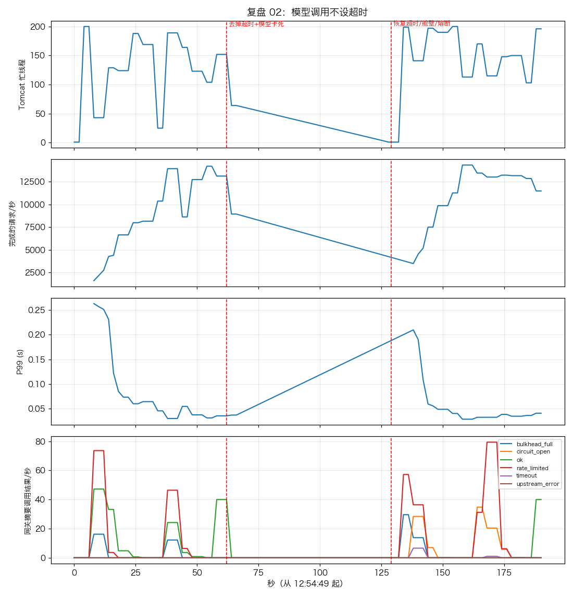

# 复盘 02：模型调用不设超时，线程池被耗尽

- 复现脚本：`scripts/incidents/02-no-timeout.sh`
- 证据：`docs/incidents/evidence/02/`（含两份完整 jstack，gzip 压缩）
- 监控图：`docs/incidents/img/02-no-timeout.png`
- 时间：2026-11-19 12:54:49 起



## 现象

热点读流量（200 VU）。第 62 秒做了两件事：

- 把整条模型调用链上的保护全部关掉：comment-service 调摘要不设 gRPC deadline；网关同步等模型、HTTP 不设超时，也没有舱壁和熔断。
- 让 mock-llm 对所有请求挂起 120 秒，模拟模型服务卡死。

| 阶段 | QPS | P99 | 错误率 |
|---|---|---|---|
| 故障前 | 9,348 | 101 ms | 0 |
| 故障中 | **5** | —（绝大多数请求超时） | **64.1%** |

更严重的是**和模型无关的接口也挂了**。评论数接口 `/comment-count` 不调模型，故障期间探测 5 次，5 次都在 5 秒客户端超时前没有任何响应（`probe.txt`）：

```
probe comment-count: http=000 time=5.004653s
...（共 5 次，全部超时）
```

## 怎么发现

1. Grafana 上 comment-service 的所有面板在第 65 秒左右**同时断线**：图中 62–130 秒是一条直线，说明 Prometheus 这段时间一个点都没抓到。原因是 actuator 和业务接口共用同一个 Tomcat，线程池满了，`/actuator/prometheus` 也进不去。监控本身出现断档，就是第一个信号。
2. k6 侧大量 `request timeout`，阈值报警（`broken.log`）。
3. 网关的摘要调用结果曲线（第 4 行）在故障期间也是 0：请求都卡在路上，既没有成功，也没有失败。

## 怎么定位

**第一步：先排除 GC。** 进程还活着但不响应，先看是不是 Full GC 停顿：

```
$ docker compose exec comment-service jstat -gcutil 1 1000 3
  S0     S1     E      O      M     CCS    YGC     YGCT     FGC    FGCT  ...
     - 100.00  40.00  84.33  98.94  96.21    351     1.888     0     0.000
```

3 秒内 YGC 次数没变，FGC 为 0。不是 GC。

**第二步：线程在干什么？**

```
$ docker compose exec comment-service jstack 1 > jstack-broken.txt
$ grep -c '^"http-nio-8080-exec' jstack-broken.txt
200
$ awk '/^"http-nio-8080-exec/ {inT=1; next} inT && /java.lang.Thread.State/ {st=$2}
       inT && /at io\.commenthub/ {print st, $2; inT=0} /^$/ {inT=0}' jstack-broken.txt | sort | uniq -c
    200 WAITING io.commenthub.ai.v1.AiGatewayGrpc$AiGatewayBlockingStub.summarize(AiGatewayGrpc.java:246)
```

Tomcat 的 200 个工作线程（`server.tomcat.threads.max`）**全部**处于 WAITING 状态，卡在同一个位置。随便取一个线程的栈：

```
"http-nio-8080-exec-1" ... WAITING (parking)
    at io.grpc.stub.ClientCalls$ThreadlessExecutor.waitAndDrain(ClientCalls.java:717)
    at io.grpc.stub.ClientCalls.blockingUnaryCall(ClientCalls.java:159)
    at io.commenthub.ai.v1.AiGatewayGrpc$AiGatewayBlockingStub.summarize(AiGatewayGrpc.java:246)
    at io.commenthub.comment.service.SummaryClient.summaryOrNull(SummaryClient.java:38)
    at io.commenthub.comment.service.CommentQueryService.summaryFor(CommentQueryService.java:144)
    at io.commenthub.comment.service.CommentQueryService.latest(CommentQueryService.java:55)
    at io.commenthub.comment.web.CommentController.list(CommentController.java:47)
```

拉评论列表时会顺带取 AI 摘要，`summaryOrNull` 用阻塞式 gRPC 调网关，没有 deadline，会一直等下去。

## 根因

一个可选功能（摘要）的依赖（模型服务）卡死，通过“同步调用 + 不设超时”一路传导到了入口：

```
mock-llm 挂起 → 网关 HTTP 调用不超时，同步等 → comment-service gRPC 不设 deadline，同步等
→ 每个列表请求占住一个 Tomcat 线程 → 200 个线程全部占满 → 所有接口（包括 actuator）都排队
```

这里没有一层出错，每一层都在“正常地等”，所以没有异常日志，只有线程堆满。线程池是整个进程共享的资源，摘要卡住，评论数、发评论、健康检查就一起卡住。

## 修复

恢复每一层的保护，各自负责一件事：

| 层 | 措施 | 作用 |
|---|---|---|
| comment-service → 网关 | 每次 gRPC 调用 `withDeadlineAfter(150ms)` | 摘要最多拖慢列表 150ms，拿不到就不显示 |
| 网关读路径 | 摘要异步生成：未命中时启动后台生成，本次直接返回 `ready=false` | 读请求根本不等模型 |
| 网关 → 模型 | HTTP 超时 = min(3s, 调用方 deadline 剩余) | deadline 向下传递，上游放弃了下游也及时放弃 |
| 网关 | 舱壁：在途调用最多 32 个，拿不到许可 20ms 内降级 | 模型再慢，占用的资源也有上限 |
| 网关 | 熔断：慢调用或失败比例 ≥50% 时打开，10 秒后半开试探 | 模型挂掉期间不再发请求 |

修复后保持 mock-llm **继续挂起**，再跑一次同样的流量。

## 修复后的数字

| 阶段 | QPS | P99 | 错误率 | 不调模型的接口 |
|---|---|---|---|---|
| 故障前 | 9,348 | 101 ms | 0 | 正常 |
| 故障中（无保护） | 5 | 超时 | 64.1% | 5/5 超时 |
| 修复后（模型仍然挂起） | **10,944** | **70 ms** | **0** | 正常 |

修复后的 jstack（`jstack-fixed.txt`）里，200 个 Tomcat 线程都是 TIMED_WAITING，在线程池里等任务，没有一个卡在 gRPC 上。修复后网关熔断器的状态是 HALF_OPEN（`breaker-after.json`），仍在周期性地试探模型。图中修复后，摘要调用结果先是 `bulkhead_full` 和 `timeout`，随后变成 `circuit_open`，说明熔断已经接管。

更完整的对比（模型延迟 10 秒、错误率 50%，持续 90 秒，3 次取中位数）见 benchmark.md 的场景 4：无保护时 Tomcat 忙线程顶到 200、读 P99 18.9 秒；有保护时忙线程峰值 14、读 P99 5.3ms。

## 后续

- actuator 改用独立端口（`management.server.port`），业务线程池满时监控不会跟着断档（还没做）。
- 所有出站调用（gRPC、HTTP、JDBC、Redis）都要有超时，在代码评审清单里写明。
