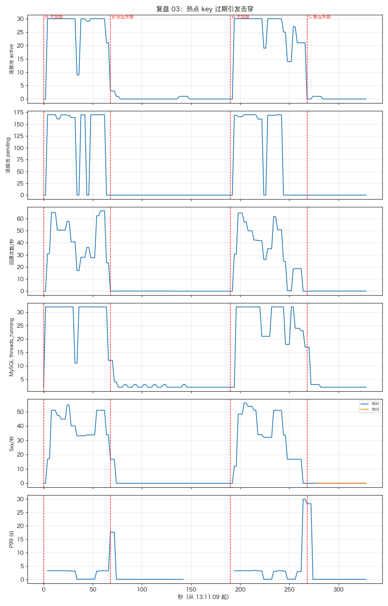

# 复盘 03：热点 key 过期引发击穿，数据库连接池耗尽

- 复现脚本：`scripts/incidents/03-breakdown-pool.sh`
- 证据：`docs/incidents/evidence/03/`
- 监控图：`docs/incidents/img/03-breakdown-pool.png`
- 时间：2026-11-19 13:11:09 起



> 这次事故发生在修复最热排序慢 SQL 之前（见 benchmark.md“慢查询”）：最热排序首页回源，是对 1 号视频 170 万条评论做一次 filesort，单次 1.3 秒。为了复现当时的状态，脚本开始时先删掉 `idx_video_like`，结束后再建回来。

## 现象

300 VU 全部请求 1 号视频的最热首页 `GET /api/videos/1/comments?sort=hot`。这是全站最热的一个 key，缓存 TTL 300 秒，演练中每 10 秒手动让它过期一次。缓存不加任何保护（`breakdown=NONE`）时：

| 阶段 | QPS | P50 | P99 | 错误率 |
|---|---|---|---|---|
| 无保护（第 1 次） | 1,890 | 24.8 ms | 3,283 ms | 2.13% |
| 无保护（第 2 次） | 2,191 | 23.0 ms | 3,123 ms | 1.53% |

P99 稳定在 3.1–3.3 秒：Hikari 的连接超时（`connection-timeout: 3000`）是 3 秒，P99 正好卡在这个值上，说明慢的请求都在连接池里排队，3 秒拿不到连接就报错。

## 怎么发现

1. Grafana 的连接池面板上，active 一直顶在 30（`maximum-pool-size`），pending 升到 170（第 1、2 行）。
2. 5xx 每秒 35–55 个（第 5 行），全部是 500。
3. 日志里大量 `Connection is not available`。

## 怎么定位

**第一步：错误是什么。** 取一条样本（`sample-error.txt`）：

```
java.sql.SQLTransientConnectionException: HikariPool-1 - Connection is not available,
  request timed out after 3001ms (total=30, active=30, idle=0, waiting=59)
```

连接池 30 个连接全被占用，还有 59 个线程在排队。

**第二步：连接被谁占着。** 第 4 行 MySQL `threads_running` 和连接池 active 一起顶在 30 左右。按 SQL 指纹聚合 A1 这一分钟的慢查询日志（`slow-top-A1-none.txt`）：

```
   71   1755.8s  avg_query_time=24.73s  avg_rows_examined=1747603  SELECT ... FROM comment WHERE video_id = N AND status <> N ORDER BY like_count DESC, id DESC LIMIT N, N
```

全是同一条最热排序首页 SQL。它单独执行只要 1.3 秒，30 份同时跑时平均每条要 24.7 秒：每份都在做全量 filesort，互相抢 CPU 和 IO。

**第三步：为什么同一条 SQL 会同时跑 30 份。** 第 3 行的回源次数（`hub_cache_db_load_total`，每次缓存未命中去查库都加 1）在每次 key 过期后冲到每秒 50–65 次。正常情况下一个 key 过期只需要回源一次。这里每个在“过期 → 回填完成”这 1 秒多窗口里到达的请求都自己去回源，而这个窗口正是 filesort 的耗时。

**第四步：按秒统计错误。** 用 grep 和 awk 按秒统计连接超时：异常行本身没有时间戳，取它前面最近一条日志的时间。

```
$ awk '/^20[0-9][0-9]-/ {ts=substr($2,1,8)} /Connection is not available/ {print ts}' comment-service.log | sort | uniq -c
      3 04:12:03
    171 04:12:06
    168 04:12:09
```

> 注意：k6 统计到的失败请求约 2,400 个，日志里只记下了 342 条。原因是日志用的是异步 appender（`neverBlock=true`，见 design.md 第 5 节），一条带堆栈的错误日志有几十行，错误爆发时队列被打满，后面的日志就被丢掉了。计数要以指标为准，日志只用来看样本。

## 根因

缓存击穿。一个访问量极高的 key 过期的那一刻，缓存里没有值，所有并发请求同时判定“未命中”，同时去执行一条很贵的回源 SQL：

```
key 过期 → 300 个并发请求同时未命中 → 30 个拿到连接，各跑一次 filesort（单独 1.3 秒，30 份并发时 24.7 秒）
→ 其余 270 个排队等连接，3 秒后超时报 500 → 回填完成前又有新请求未命中……
```

数据库同时跑 30 份同样的 filesort，每份都比单独跑慢得多，回填窗口被拉长，进来的未命中请求更多，形成正反馈。

## 修复

`breakdown=MUTEX`（`PageCache.withMutex`）：

1. 未命中时先抢 Redis 锁 `SET lock:<key> <token> NX PX <租期>`；
2. 抢到锁的请求再读一次缓存（double check），仍未命中才回源，回填后用 Lua 脚本校验 token 再删锁；
3. 没抢到的请求每 20ms 重读一次缓存，最多等 2 秒。

这样无论有多少并发，一次过期只回源一次。

演练中还发现并修改了两处细节：

- **锁租期从 5 秒改为 30 秒。** 租期必须比最慢的一次回源长，否则回源还没结束锁就过期了，下一个请求又会抢到锁再回源一次。正常情况下回源只要 1.3 秒；但数据库已经被打满时，一次回源要 20 多秒。
- **等锁超时从“自己回源”改为返回 503 + `Retry-After: 1`。** 等了 2 秒还没等到，说明数据库正在吃力，这时再回源只会加重负担。

这两处来自第一次演练。当时有一个阶段，互斥锁打开后连接池仍然被占满，慢查询日志里那两分钟有 94 条最热排序 SQL，平均耗时 29 秒。后续的正式演练里，B、C 两个阶段都紧接在“无保护”阶段之后开始，那个现象没有再稳定复现。所以这里只把它当作加固，不算作这次事故的根因。新旧两种行为都留成了开关（`mutexLockTtlMs`、`mutexFallback`），复盘脚本里两种都跑了一遍。

## 修复后的数字

脚本分两组跑：A1 → B（修复前的互斥锁：租期 5 秒、超时回源），冷却 60 秒，然后 A2 → C（修复后：租期 30 秒、超时返回 503）。B 和 C 都在数据库刚被 A 打满之后立刻开始。

| 阶段 | QPS | P50 | P99 | 错误率 | 连接池超时次数 | 连接池 active / pending 峰值 |
|---|---|---|---|---|---|---|
| A1 无保护 | 1,890 | 24.8 ms | 3,283 ms | 2.13% | 342（日志记下的） | 30 / 170 |
| B 互斥锁（修复前参数） | **21,730** | 9.4 ms | **38.5 ms** | **0** | 0 | 3 / 0 |
| A2 无保护 | 2,191 | 23.0 ms | 3,123 ms | 1.53% | 159（日志记下的） | 30 / 170 |
| C 互斥锁（修复后参数） | **20,311** | 9.8 ms | **44.9 ms** | 0.01% | 0 | 1 / 0 |

QPS 提高约 10 倍，P99 从 3 秒以上降到 40ms 左右，连接池超时降为 0。C 的 0.01% 错误是 503：切换后的第一次重建，还在和 A2 留下的慢查询抢资源，等锁超过了 2 秒，图中第 5 行的橙线就是它们。

在不删索引的正常状态下，benchmark.md 的“缓存击穿”一节也有同样的三组对比（3 次取中位数），其中逻辑过期版本过期后返回旧值、单线程异步重建，P99 52.9ms。

## 后续

- 修复最热排序慢 SQL（覆盖索引 `idx_video_like`）之后，同一个回源从 1.3 秒降到 0.25ms，击穿的代价也小了很多。互斥锁仍然保留：下一个“很贵的回源”不一定能靠加索引解决。
- 错误日志被异步 appender 丢弃的问题：给 ERROR 级别单独配一个同步的、只写首行不写堆栈的 appender，或者按异常类型限流打印（还没做）。
